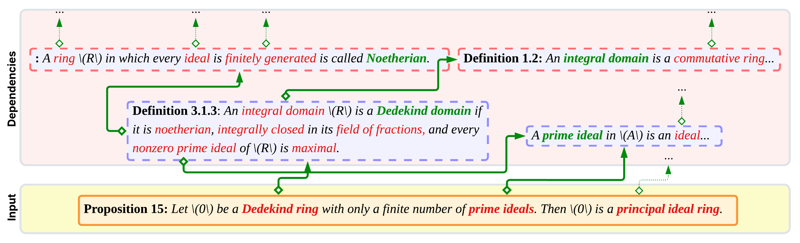

# MathAtlas

**A benchmark for autoformalization of graduate-level mathematics *in the wild*.**

Most autoformalization benchmarks cover olympiad or undergraduate math, where the background theory is small and usually already in Mathlib. Graduate math is different. Before you can formalize a theorem, you often have to find or formalize a long chain of definitions it depends on.

MathAtlas is built to study that setting. It contains about **52k theorems, definitions, exercises, examples and proofs**, extracted from **103 graduate textbooks** across 87 areas of math. These are linked by about **178k dependency relations**.



*To formalize Proposition 15 (bottom), you first need "Dedekind ring", "prime ideal" and "principal ideal ring". Each of those has its own dependencies, and so on up the tree.*

## What's in the dataset

- **Entities**: spans of textbook text that can be formalized: definitions, theorems, proofs, examples and exercises.
- **References**: the other entities, mathematical objects and local variables that an entity mentions.
- **Relations**: links from each reference to the entity that defines it. Together these form a dependency graph. An entity's *dependency depth* is the height of its dependency tree.
- **Mathlib grounding**: for definitions, the matching Mathlib declarations where they exist.

We also release two smaller benchmarks:

- **MA-Hard**: about 700 entities with the deepest dependency trees, mostly from fields like algebraic geometry and Lie theory.
- **MA-Align**: 200 human-labeled formalizations (statements and definitions) for evaluating *semantic faithfulness* metrics.

## Key findings

- **Single-pass systems struggle.** The best scores are 9.8% correct on statements and 16.7% on definitions. Performance drops as dependency depth grows.
- **Compiler feedback helps compilation, not faithfulness.** Iterating on errors gets almost everything to compile, but it doesn't make the outputs more faithful to the source.
- **Agents work but are expensive.** Claude Code with access to the dependency graph reaches 64% correctness on MA-Hard, at about 6× the cost of a single pass. Efficiency is a key open problem.
- **Faithfulness metrics have room to improve.** Existing judges score noticeably worse on MA-Align than on undergraduate-level benchmarks.

## Getting the data

- MathAtlas (open split): <https://huggingface.co/datasets/MathAtlas/MathAtlas>
- MA-Align: <https://huggingface.co/datasets/MathAtlas/MA-Align>

About 40% of entities come from Springer textbooks and can't be redistributed. The open split has the remaining 60%, including all of MA-Hard. If you have access to the Springer books, you can rebuild the full dataset with the pipeline below. The open-access books are listed in [`open-books.txt`](open-books.txt).

## Building the dataset

The pipeline turns textbook PDFs into a dependency graph:

1. Convert the PDFs to Mathematical Markdown with [Nougat](https://github.com/facebookresearch/nougat) and filter out non-content pages.
2. Extract entities, then their references and (for definitions) the names they define.
3. Embed the entities and link each reference to the entity that defines it.
4. Ground definitions to Mathlib using LeanSearch.

The extraction, linking and grounding steps use a prompted LLM (we used `gpt-oss-120b`) served with vLLM. The prompts are in [`prompts/`](prompts) and the output JSON schemas are in [`schemas/`](schemas).

### Setup

```bash
uv sync
```

Each step is a small CLI in `src/math_atlas/`. Run them from the repo root (they load `prompts/` and `schemas/` by relative path), and pass `--help` to see the options:

| Step | Command |
| --- | --- |
| Extract entities | `uv run python src/math_atlas/extract.py items` |
| Extract defined names | `uv run python src/math_atlas/extract.py names` |
| Extract references | `uv run python src/math_atlas/extract.py references` |
| Locate entities in the source text | `uv run python src/math_atlas/locate.py` |
| Embed entities into ChromaDB | `uv run python src/math_atlas/embed.py` |
| Link references to entities | `uv run python src/math_atlas/link.py` |
| Ground definitions to Mathlib | `uv run python src/math_atlas/ground.py` |

Optionally, you can load the graph into Neo4j to browse it:

```bash
docker compose up -d                       # starts Neo4j on localhost:7474
uv run python src/math_atlas/insert.py
```

## Paper

The paper source is in [`paper/`](paper). It covers dataset construction, the quality analysis and the full experimental results.
